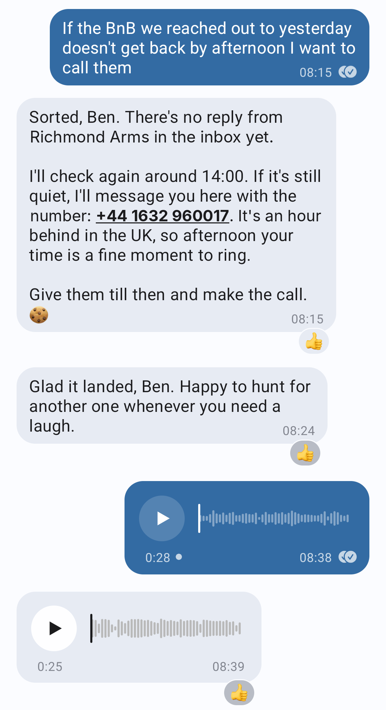

# Ted

**Proactive personal assistant with a character, who organises your calendar, emails, tasks and meetings, and can do research on the web for you.**

## Why it feels like a person

- **A character, by default Ted Lasso.** Warm, folksy and relentlessly optimistic. Change it by telling Ted what you want.
- **Typing, seen, reactions.** It marks your message read, shows "typing..." while it works, and sometimes answers with just an emoji on your message. 
- **Voice in and out.** A voice note is transcribed on your Mac. Ted may answer with a voice message when that fits, generated locally. Out of the box it speaks with a stock local voice (Kokoro, `am_onyx`; this repo ships no recordings of anyone). To give Ted a voice of your own, send a voice message of about 10 seconds in the chat and ask it to use that voice; it speaks in it from then on, per conversation (needs `TTS_PROVIDER=qwen`, see docs/REMOTE-TTS.md). Use your own voice, or one whose owner agreed: a clip taken from a film, a show or a public figure is someone else's voice and someone else's recording.
- **Pictures, PDFs and text files.** Send a picture, a PDF or a text file and Ted reads it. When browsing the web it can send you screenshots of what it sees.
- **Browse the web.** It has a browser it can use to research for you online, and tells you what it is up to before a long errand.
- **Groups, where it decides when to speak.** Add Ted to a group and a small model judges each message: Ted always answers when addressed and otherwise joins in only when it fits. Each group has its own notes and history, and Ted brings none of your private data there.
- **Smart memory and context.** Ted remembers relevant details about you, your preferences and recurring tasks. A nightly dream organises memory. Context is automatically populated with relevant tools, recent messages, memory, and compacted above a threshold.
- **Smart about asking for permission.** A small model judge decides what is a safe action and when to ask you for confirmation, like sending an email.
- **Proactive.** Wakes up every 15min to check if anything needs acting on (via small model judge).
- **Its own contact.** Give Ted its own Signal account (a name, a picture) and you chat with a contact instead of with yourself.
- **Pre-configured as a helpful personal assistant.** Comes with skills out of the box to be a helpful personal assistant.

## Personal assistant

- **Inbox.** Every 15 minutes it checks for new mail. Newsletters, notifications and cold outreach are archived (never deletes). Anything that needs you arrives as one short message on Signal. When appropriate a reply is drafted automatically for you to review.
- **Meeting prep** from your Notion meeting database and past threads.
- **Tasks.** It reads your Notion task list, spots what is overdue, adds tasks from mail and removes ones clearly done. Chat with it to get a brief on what's up next, or to add/tick off tasks.
- **Calendar.** Creates events from mail, flags conflicts and proposes fixes. Plain events on your own calendar just happen (logged); anything with other people asks.
- **Daily brief.** An email sent to you once a day in the morning with a key focus for the day based on tasks, emails and calendar, upcoming calendar events, what it did since the last brief (emails that were auto-archived), and newsletter digest.
- **Newsletter digest.** The top three nuggets, based on your preferences, in the daily brief.

Tasks, meeting prep and calendar need the Notion and Google Calendar connectors. Without one, Ted skips that part and says so. It helps you point it to the right page in Notion if it doesn't find it automatically.

## Setup

Just ask Claude Code to set up the repo and install dependencies. Then start Ted, it will automatically look where in Notion you keep your tasks and meetings, and confirms those with you.

By default it uses the "Note to self" chat on Signal, but for a better experience consider creating a dedicated Signal account for Ted so you can chat to him as its own user and add him to groups.

Step by step: [docs/SETUP.md](docs/SETUP.md).

## Safety

- **A judge that can skip questions, inside a floor.** A small model may skip a few low-risk questions (such as a new calendar event with nobody else on it). The floor is code: sends, forwards, shares and anything involving other people always ask. Skips are logged, and `AUTO_APPROVE=off` turns the judge off.
- **Approvals with the exact arguments.** Sending, forwarding, sharing and anything that involves other people ask first.
- **A browser with guard rails.** Browsing runs in a separate, throwaway browser with no logins and none of your data. A small judge decides whether a step is read-only (searching, filtering) or books, buys or sends something, and anything like that asks you first. Payment and login fields always ask you, and the address checks that keep the browser away from your own machine and network are code, not a model decision.
- **Permission policy in code.** Every tool call is allow, ask or deny in `src/policy.ts`, tested against real tool names. Deletes are denied. Memory can shape tone and priorities but never grant permissions.
- **Untrusted content cleaned at the door.** Messages, mail, web pages and tool results lose hidden and look-alike characters and invisible HTML before a model reads them, and are treated as data.
- **What this is not.** This is application-level policy running on your Mac as your user. It is **not** OS-level or container isolation. Prompt injection is contained and tested, not eliminated: a hostile mail can still try. `signal-cli` keeps its keys unencrypted on disk, so keep FileVault on.
- **Tests.** Full test suite ensures the code behaves as expected.
- **Logging.** Every decision and action is logged and can be inspected for behaviour (`npm run report`).

Full details: [docs/SAFETY.md](docs/SAFETY.md).

## A day in the life: AFC Richmond edition

*(Characters borrowed with love from Ted Lasso. Nobody at Richmond has been consulted.)*

**Tuesday, 07:00.** Your Mac wakes and the daily brief starts. The full brief lands in your inbox. On Signal you get the short version:

> **💪 Pep talk**
> Mornin', Coach! Now, I know the inbox looks like a pile of angry geese, but today is really just three things, and you've handled worse before your first biscuit. Answer the Board before 11:00 and everything else is a nice, easy warm-up.
>
> **🎯 Focus**
> **Answer Rebecca about the stadium budget before 11:00.** She's asked twice, and the second message just says "Ted. Budget."
> - Press conference prep at 14:00, the prep page is ready.
> - Ring the boiler repairman. Again.

**10:42.** An urgent mail arrives while you are in a meeting, so you get exactly one alert:

> Keeley Jones needs your decision on the PR plan by noon: the whole campaign is waiting on a yes or no.

**Any time.** Just talk to Ted, in text or a voice note:

> **You:** what's on my plate today?
> **Ted:** Three things, and not one of them is a lion! 🦁
> - **Rebecca** wants an answer on the budget by 11:00.
> - Kickball clinic at 17:30 collides with the Sponsors' Brunch. I'd move the brunch. Nobody ever won a championship over a quiche.
> - Your coaching licence is 4 days overdue. No judgment here, buddy.
>
> **You:** remember that messages from Jamie are never urgent
> **Ted:** Saved: Jamie's "URGENT!!!" emails will now wait their turn. Which, between you and me, is a long line.

**11:20.** Anything involving other people waits for your say-so, and Ted asks like a person would:

> **You:** put "find a decent cup of tea" in my calendar tomorrow at 15:00, and invite Coach Beard
> **Ted:** Happy to! That's "find a decent cup of tea" tomorrow at 15:00, with Coach Beard invited. Shall I send him the invite?
>
> **You:** yes but make it 16:00
> **Ted:** Done: moved to 16:00 and the invite is on its way to Beard.

**12:30.** The Richmond group chat. Ted is in there too, with notes and a memory of its own, and none of yours:

> **Roy:** *(sends a voice note)* Ted, talk as me.
> **Ted:** 🎤 Voice's saved: from now on I'll sound like Roy in this group only. Say "normal voice" and I'm back to me.
> **Keeley:** Who's up for team drinks after training?
> **Ted:** *(in Roy's gravelly voice)* Fine. But I'm not wearing the hat.

**14:10.** You forward Rebecca's budget as a PDF:

> **Ted:** Pages 3 and 7 are the ones to read. The stadium line is up 12%, and she's buried the reason on page 7. Want me to draft her a reply?

**16:45.** The long errand:

> **You:** find me a train to London on Tuesday
> **Ted:** On it, checking SBB and Omio.
> *(a minute later)*
> **Ted:** The 06:59 is the one: 8h36, one change, around CHF 230 to 330. I couldn't confirm the exact fare, so call that a range. Here's what SBB showed me. *(screenshot)* I'd book it yourself from this link, since I stop before anything that costs money.

## How it compares

Personal agents are having a moment. Ted is deliberately narrow: one person, your own Mac, Signal as the front door, and a question on your phone before anything leaves it. The cells for other products come from public descriptions, not from using them.

| | **Ted** | **[OpenClaw](https://en.wikipedia.org/wiki/OpenClaw)** | **[Grok Bot](https://www.vellum.ai/blog/official-grok-bot-breakdown)** | **[Instinct](https://www.vellum.ai/blog/official-instinct-breakdown)** |
|---|---|---|---|---|
| **What it is** | A personable assistant in your Signal chats, with heartbeat, memory, browsing and mail, calendar and task skills out of the box | A general-purpose agent platform | A general agent on a cloud computer | A general assistant you text or call |
| **Before it acts** | Code-enforced policy: reads run, outward actions ask on your phone (in chat, a send you asked for exactly may go through on a small model's judgement), deletes are denied | Per-agent tool permissions; sandboxed or full system access, your choice | Allow once / always / deny, plus auto-review rules | Reported by Vellum: no approval step required for actions. Corrections welcome |
| **Source** | Open (MIT)| Open, large | Proprietary | Proprietary |
| **Cost** | Your Claude plan. Measured in October 2026 with Sonnet: about $0.01 for a simple warm reply, $0.03 to $0.08 for a calendar question | Free software plus your model costs | $200/month, or bundled with SuperGrok Heavy and Cursor plans | Free in invite-only beta, pricing not published |
| **Runs on** | Your Mac | Your machine or server | xAI's cloud | The vendor's cloud |
| **Where you talk to it** | Signal (swappable for Telegram, Slack...) | WhatsApp, Telegram, Signal, Slack, iMessage and more | Desktop and iPhone app | iMessage, WhatsApp, phone calls |

**Ted may suit you** if you want a small, readable assistant for one person that comes with personality and personal assistant skills out of the box. **OpenClaw** fits a broad, self-hosted agent that needs a lot more technical setup. **Grok Bot or Instinct** fit if you would rather have a hosted product than run anything yourself.

## Make it yours

- **Your preferences**: personality, tone, length, who matters, what the brief includes. They live in small notes (`memory/notes/`) that you can also change by chatting. No code, no restart.
- **Your mail**: it ships with [Mailbird](https://www.getmailbird.com/). If you use Gmail only, set `MAIL_PROVIDER=gmail` to use your Claude account's Gmail connector instead and skip the local client ([docs/SETUP.md](docs/SETUP.md#gmail-no-local-mail-client)).
- **Your messenger**: Signal is a thin layer. Telegram, Slack, iMessage and WhatsApp are realistic swaps.
- **Your rules**: what runs unattended, what needs approval and what is blocked is one short, tested file.

How to do each: [docs/ADAPTING.md](docs/ADAPTING.md).

## Docs

|||
|---|---|
| [Setup](docs/SETUP.md) | requirements, install, skills, daily use, tuning |
| [Safety](docs/SAFETY.md) | what it can and cannot do, and how that is enforced |
| [Architecture](docs/ARCHITECTURE.md) | how it works, project layout, development |
| [Adapting](docs/ADAPTING.md) | Proton and Mailbird, Gmail directly, other messengers, other tweaks |

## License

[MIT](LICENSE)
