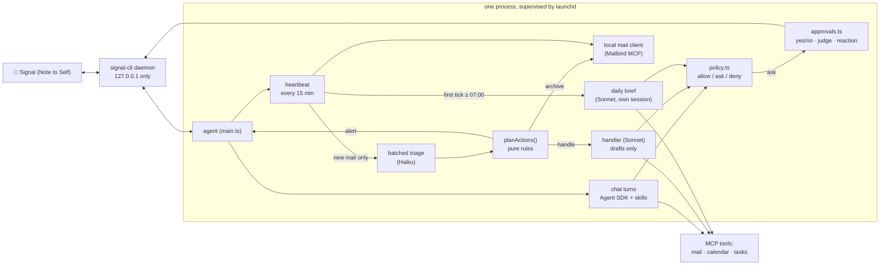

# Ben-E

A personal assistant agent that lives on your Mac. You talk to it from your phone over **Signal**, it watches your inbox with a cheap **heartbeat**, deals with what it safely can, tells you about what needs you, and sends you one **daily brief**. It is built on the [Claude Agent SDK](https://docs.claude.com/en/api/agent-sdk/overview) and your own Claude Code skills.

It is a small, readable harness (about 2,500 lines of TypeScript plus tests, no framework), written to be adapted: the name, persona, mail provider, messenger and permission policy are all meant to be swapped. See [docs/ADAPTING.md](docs/ADAPTING.md).

> **Status:** a personal project that runs daily for its author. It works, it is tested (`npm test`), and it is opinionated about safety. It is not a polished product: macOS only, one user, and you are expected to read the code before trusting it with your inbox.

## What it does

| | |
|---|---|
| **Chat** | Message yourself on Signal ("Note to Self"). It answers in a persona you define (sassy by default), with access to your mail, calendar and task tools through your Claude Code skills. |
| **Heartbeat** | Every 15 minutes (not at night) it lists your inboxes with **no model call**. Only if something new arrived does a small model (Haiku) classify *all* new mail in one batch: needs you / assistant can handle / read later / archive. |
| **Acts on mail** | Clear noise (newsletters, notifications, cold outreach) is archived. Mail that needs you becomes **one batched Signal message**. Routine mail (e.g. a meeting request) goes to a Sonnet handler that checks your calendar and **drafts** a reply. Invoices, bills, tax, policy and official mail are never archived automatically. |
| **Daily brief** | On the first heartbeat after 07:00 (late is fine, once per day) it sweeps what is left, tidies your tasks, reviews your calendar, preps meetings, and delivers one brief by **email and Signal** (one message per section). It builds on yesterday's brief, kept in a local file. |
| **Approvals on your phone** | Anything outward-facing (send, forward, calendar changes, sharing) asks first. Answer with `yes` / `no`, a natural sentence ("sure, go ahead"), a 👍/👎 **reaction**, or an edit ("yes but make it 16:00"). |

## How it works



**Key design decisions**

- **The heartbeat is not a model.** Detecting new mail is a plain API call. The model runs only when something changed, and then once per batch, so a quiet inbox costs nothing.
- **Permissions are code, not prompts.** Every tool call passes `policy.ts`, which returns *allow* (reads, plus routine writes such as archive and drafts), *ask* (anything outward-facing or unknown), or *deny* (delete, trash, spam, block, and the one financial connector the default policy knows by name, which you should extend). A prompt can ask the model to behave; only code can make it.
- **Email is untrusted input.** The classifier sees mail as data, runs with no tools, and returns constrained JSON. Mail containing instruction-like text is classified *alone* (so it cannot influence its neighbours) and can never be auto-archived. Archiving needs the label, the *kind* and the protected-mail guard to agree.
- **State is local and small.** Last brief, seen-message ids, the audit log and the cost counter live in `state/` (owner-only permissions). The agent has no file tools; the harness injects what it needs into prompts.

## Safety model

| Layer | What it does |
|---|---|
| Owner allowlist | Only your own *Note to Self*, from your own number, is ever acted on. Your linked device also receives all your other Signal traffic; it is dropped and logged with a masked number. (`guards.ts`, tested) |
| Tool policy | allow / ask / deny in `policy.ts`, tested against real tool names. Unknown tools default to *ask*. |
| Approvals | Fail closed: a timeout or any doubt means *no*. Edit-and-approve is limited to calendar create/update, never to recipients or attendees. A model judge for free-text replies returns constrained output; a rambling answer cannot become an approval. |
| Reversible by default | Mail is only archived (never deleted), every archive is recorded with ids, and `npm run restore <id>` brings it back. At most 25 archives per tick. |
| Spend guard | A daily ceiling pauses *background* work (brief retries, the handler); chat stays available. |
| Observability | `state/audit.jsonl` records every tool decision (ids, never email content, for chat). `state/agent.log` is redacted (numbers, tokens) and rotated. `npm run report` shows what the heartbeat did. |
| Kill switches | `touch state/paused` pauses everything (put a date inside to resume on it). `HEARTBEAT_ACTIONS=log` makes the heartbeat record decisions without acting. |

Known limits: `signal-cli` stores its keys unencrypted on disk (keep FileVault on); its local socket is unauthenticated (it listens on `127.0.0.1` only); anything running as your user can reach it. Prompt injection cannot be solved, only contained: the design above limits what a hostile email can make the agent do, it does not make it impossible to try.

## Requirements

- **macOS** (launchd supervises the agent; Mailbird is the mail client). Linux would work for everything except those two.
- **Node 24+** (TypeScript runs directly, there is no build step).
- **[Claude Code](https://docs.claude.com/en/docs/claude-code/overview)** installed and logged in (`claude auth login`). The agent uses your stored login so it can reach your claude.ai connectors (Notion, Google Calendar, Gmail…). *Check Anthropic's current terms for using your plan for personal automation like this.* An API key or `claude setup-token` also work but cannot use those connectors (see `HARNESS_AUTH` in `.env.example`).
- **[signal-cli](https://github.com/AsamK/signal-cli)** (`brew install signal-cli`), linked to your Signal account as a secondary device.
- **A mail client with an MCP server.** This repo uses [Mailbird](https://www.getmailbird.com/); see [Why a local mail client](#why-a-local-mail-client) and [docs/ADAPTING.md](docs/ADAPTING.md) if you use Gmail only.
- Optional: Notion and Google Calendar connected under *claude.ai → Settings → Connectors*, for the task and calendar parts of the brief.

## Setup

```bash
git clone https://github.com/<you>/assistant-harness && cd assistant-harness
npm install

# 1. Link Signal (scan the QR code in Signal → Settings → Linked devices)
signal-cli link -n "ben-e"            # prints a sgnl:// link; turn it into a QR code, e.g.
                                      #   brew install qrencode && qrencode -t ANSIUTF8 '<link>'

# 2. Configure
cp .env.example .env && chmod 600 .env
$EDITOR .env                          # at least SIGNAL_OWNER_NUMBER; set OWNER_NAME / ASSISTANT_NAME

# 3. Mail: make sure `claude mcp list` shows your mailbird server as connected
#    (the agent reads its connection details from the same entry in ~/.claude.json)

# 4. Skills: copy the example brief skill and write the ones you use
cp -r examples/skills/daily-brief ~/.claude/skills/
#    plus your own mailbird / notion-tasks / calendar / meeting-prep skills (see below)

# 5. Check everything, then run it for real
npm run doctor
npm run install:launchd               # installs a launchd job; the agent starts now and at login
```

Send yourself a message on Signal. The first heartbeat tick only records a **baseline** of your current inbox (it does not triage old mail). The first daily brief runs on the next tick at or after 07:00.

### Skills

The agent does its domain work through ordinary Claude Code skills in `~/.claude/skills/`. The repo ships one example, `examples/skills/daily-brief/SKILL.md` (the brief's structure and rules), and expects you to provide the ones it orchestrates, each describing *how you* want that domain handled:

| Skill | Role |
|---|---|
| `mailbird` | triage rules, your reply voice, the newsletter-radar rules |
| `notion-tasks` | your task database schema and tidy rules (every deadline becomes a task) |
| `calendar` | conflict flagging, travel-booking events |
| `meeting-prep` | when a meeting needs prep, where prep pages live |

Drop any you do not use and delete the matching steps from the brief skill. Your skills hold personal details, which is why they are not in this repo.

## Daily use

- **Chat**: message yourself. Replies are formatted with Signal's native styles (bold, italic, strikethrough, monospace).
- **Approve**: reply `yes` / `no`, a sentence, or react 👍 / 👎 on the question.
- `npm run doctor`: health check (tooling, permissions, Signal, Mailbird, login, launchd, skills, recent errors).
- `npm run report [hours]`: what the heartbeat archived, alerted and queued.
- `npm run restore <conversationId>`: put an archived conversation back in the inbox.
- `npm test` / `npm run typecheck` / `npm run check:secrets`.
- Logs: `state/agent.log` (rotated). Audit trail: `state/audit.jsonl`.
- Tuning: every knob is an env var, listed in `.env.example` (heartbeat interval, quiet hours, brief start hour, archive cap, spend limit, model).

## Why a local mail client

If any of your mail is on **Proton Mail**, there is no server to point an agent at. Proton is end-to-end encrypted, so a third party cannot read your mailbox through a normal API, and plain IMAP is not offered. The supported way in is **Proton Mail Bridge**, a small app that runs on your computer, decrypts mail locally, and exposes it as IMAP/SMTP on `localhost`. So the agent has to run on a machine where the Bridge is running.

[Mailbird](https://www.getmailbird.com/) sits on top of that: it connects to the Bridge *and* to Gmail and others, presents them as one inbox, and ships a **local MCP server**. This agent talks to that MCP server directly (`src/mailbird.ts`) for the heartbeat, and the Claude agent uses the same server for reading and drafting. The cost of this approach: Mailbird must be running, and the agent only works while your Mac is awake. The benefit: Proton, Gmail and anything else Mailbird supports all look the same.

**If your mail is Gmail only, you do not need any of this.** You can talk to Gmail's API directly (or use the Gmail connector Claude already offers), and the heartbeat could even run on an always-on server. [docs/ADAPTING.md](docs/ADAPTING.md) lists exactly which functions to replace.

## Why Signal

A phone is the right place to talk to something that watches your inbox: it is always with you, and it supports **reactions**, which make one-tap approvals possible. Signal in particular gives you end-to-end encryption between phone and Mac, a "Note to Self" thread that nobody else can write into, and `signal-cli`, a well-maintained client that runs as a linked device. The agent only ever reads that one thread.

The messenger is a thin layer (`signal.ts`, `signal-daemon.ts`, `markdown.ts`, `outbound.ts`, `guards.ts`), so Telegram, Slack, iMessage or WhatsApp are realistic swaps. [docs/ADAPTING.md](docs/ADAPTING.md) describes the contract each piece has to meet.

## Project layout

```
src/main.ts          wiring: Signal in, chat turns, heartbeat, brief, approvals
src/signal*.ts       signal-cli JSON-RPC client and daemon supervision
src/markdown.ts      Markdown → Signal text styles (UTF-16 offsets)
src/outbound.ts      sending, chunking, echo guard
src/guards.ts        owner allowlist (pure, tested)
src/agent.ts         Agent SDK runs: chat / brief / handler, permission callback
src/policy.ts        allow / ask / deny + edit-and-approve rules (pure, tested)
src/approvals.ts     pending approvals: words, judge, reactions
src/judge.ts         constrained Haiku judge for free-text approval replies
src/heartbeat.ts     the tick: check mail, triage, act, hand off
src/triage.ts        batched classifier + injection isolation + protected-mail guard
src/actions.ts       what to do with a classification (pure, tested)
src/handler.ts       Sonnet handler for routine mail (persistent queue)
src/brief.ts         daily brief trigger and run (pure schedule logic, tested)
src/digest.ts        what the heartbeat did, for the brief
src/mailbird.ts      direct MCP client for the local mail server
src/budget.ts        daily spend guard
src/audit.ts         append-only audit log
src/cli.ts           doctor / report / restore
test/                unit tests (node:test)
scripts/             launchd install, secrets scanner
```

## Development

```bash
npm test                # unit tests, no network or accounts needed
npm run typecheck
npm run check:secrets   # scans files git would commit; run before every commit
```

The pure modules (`policy`, `actions`, `brief` scheduling, `markdown`, `guards`, `digest`) carry the safety-critical logic and are where tests concentrate. Anything that touches Signal, Mailbird or a model is thin on purpose.

## License

See [LICENSE](LICENSE).
