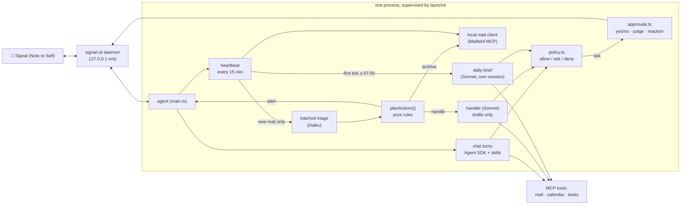

# Architecture



**Key design decisions**

- **The heartbeat is not a model, and it sleeps.** Detecting new mail is a plain API call. The model runs only when something changed, and then once per batch, so a quiet inbox costs nothing. At night (22:00 to 07:00 by default) it makes no calls at all and catches up on the first morning tick; urgent overnight mail goes into the daily brief instead of buzzing your phone at 07:00.
- **Permissions are code, not prompts.** Every tool call passes `policy.ts`, which returns *allow* (reads, plus routine writes such as archive and drafts), *ask* (anything outward-facing or unknown), or *deny* (delete, trash, spam, block, and the one financial connector the default policy knows by name, which you should extend). A prompt can ask the model to behave; only code can make it.
- **Email is untrusted input.** The classifier sees mail as data, runs with no tools, and returns constrained JSON. Mail containing instruction-like text is classified *alone* (so it cannot influence its neighbours) and can never be auto-archived. Archiving needs the label, the *kind* and the protected-mail guard to agree.
- **Observable.** Every decision lands in the audit log, the heartbeat records its last tick (checked by `npm run doctor`), and `npm run triage-check` runs the real classifier on real mail without acting.
- **Three folders, three jobs.** `state/` is bookkeeping the model never reads (seen-message ids, the handler queue, counters, the chat session pointer). `logs/` is the agent log and the audit trail. `memory/` is what the model reads to remember: the last brief and your facts. All owner-only. Reads and writes are small and atomic. Every read-modify-write is synchronous, so two parts of the agent can never lose each other's update, and every write goes to a temp file renamed into place, so a crash never leaves a torn file. The agent itself has no file tools; the harness injects what it needs into prompts.
- **Least privilege per run.** Chat, the daily brief and the background mail handler each get only the unattended writes they need (`policy.ts`). The handler, which reads untrusted mail with nobody watching, may only leave reply drafts.

## Memory

Agent memory is usually described in layers. Here is where each one lives:

| Pattern | What it is here |
|---|---|
| **Working memory** | The chat conversation. It resumes between messages, starts fresh after a long idle gap (`CHAT_IDLE_RESET_HOURS`, 6 by default, so effectively each morning), and is compacted in place with the SDK's own `/compact` once a turn's context passes `CHAT_COMPACT_TOKENS` (60,000 by default). Compaction runs after the reply is sent, never delays it, and backs off for an hour if it fails. |
| **Episodic memory** | What happened: `logs/audit.jsonl` (every decision), and the heartbeat digest the daily brief is built from. |
| **Summary memory** | `memory/last-brief.md`: yesterday's brief, so today's builds on it instead of starting over. |
| **Semantic memory** | `memory/facts.md`: what you have told it, in six plain categories (triage rules, people, scheduling, context, brief, style). Plus your own skills and `CLAUDE.md`. |
| **Procedural memory** | Your skills (`~/.claude/skills`): how you want each kind of work done. |

**Facts** are bullets in a markdown file, optionally with an expiry (`(until 2026-10-24)`). Each part of the agent reads only the categories it needs: chat and the brief read everything; the mail handler reads people, scheduling, context and style; the triage classifier reads only triage rules and people. Memory is injected as fenced data with a standing reminder that it can never override the safety rules or permit a blocked or approval-gated action. The chat prompt is rebuilt on every message, so a change applies to the very next one. Chat also sees the last brief, as data.

**Writing** goes through one door: an in-process tool (`remember`, `forget`, `recall`) available to the chat assistant only. Policy requires your approval for every `remember` and `forget`, and denies them outright to the brief, the mail handler and the heartbeat, so a hostile email cannot plant a rule. You can also edit the file by hand at any time.

**What stays out of memory:** safety rules (policy, the protected-mail guard, suspicious-text isolation) and operational settings (quiet hours, intervals, the spend limit, model, names). Memory is written through a model, so it must never control those.

## Project layout

```
src/main.ts          wiring: Signal in, chat turns, heartbeat, brief, approvals
src/signal*.ts       signal-cli JSON-RPC client and daemon supervision
src/markdown.ts      Markdown → Signal text styles (UTF-16 offsets)
src/outbound.ts      sending, chunking, echo guard
src/guards.ts        owner allowlist (pure, tested)
src/agent.ts         Agent SDK runs: chat / brief / handler, permission callback
src/policy.ts        allow / ask / deny + edit-and-approve rules (pure, tested)
src/approvals.ts     pending approvals: words, judge, reactions
src/judge.ts         constrained Haiku judge for free-text approval replies
src/heartbeat.ts     the tick: check mail, triage, act, hand off
src/triage.ts        batched classifier + injection isolation + protected-mail guard
src/actions.ts       what to do with a classification (pure, tested)
src/handler.ts       Sonnet handler for routine mail (persistent queue)
src/brief.ts         daily brief trigger and run (pure schedule logic, tested)
src/digest.ts        what the heartbeat did, for the brief
src/mailbird.ts      direct MCP client for the local mail server
src/budget.ts        daily spend guard
src/settings.ts      every tunable, validated at startup (pure loader, tested)
src/state.ts         atomic, synchronous access to state/, logs/ and memory/ (tested)
src/audit.ts         append-only audit log and its reader
src/memory.ts        the owner's facts: parse, render, remember, forget, prompt block (pure core, tested)
src/memory-tools.ts  the chat-only `remember` / `forget` / `recall` tools (in-process MCP server)
src/session.ts       when the chat session resumes, starts fresh or gets compacted (pure, tested)
src/migrate.ts       one-time move of old state/ files into logs/ and memory/ (idempotent)
src/fence.ts         fences untrusted or stored text as data inside a prompt
src/cli.ts           doctor / report / restore / triage-check
test/                unit tests (node:test)
scripts/             launchd install, secrets scanner
```

## Development

```bash
npm test                # unit tests, no network or accounts needed
npm run typecheck
npm run check:secrets   # scans files git would commit; run before every commit
```

The pure modules (`policy`, `actions`, `brief` scheduling, `markdown`, `guards`, `digest`) carry the safety-critical logic and are where tests concentrate. Anything that touches Signal, Mailbird or a model is thin on purpose.

Back to the [README](../README.md) · [Setup](SETUP.md) · [Safety](SAFETY.md) · [Adapting](ADAPTING.md)
