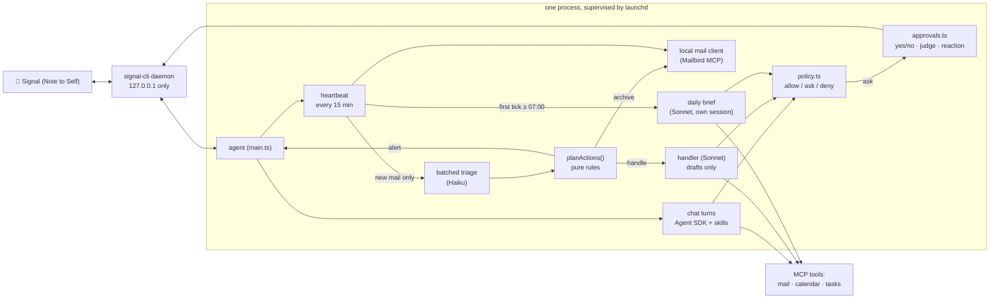

# Architecture



**Key design decisions**

- **The heartbeat is not a model, and it sleeps.** Detecting new mail is a plain API call. The model runs only when something changed, and then once per batch, so a quiet inbox costs nothing. At night (22:00 to 07:00 by default) it makes no calls at all and catches up on the first morning tick; urgent overnight mail goes into the daily brief instead of buzzing your phone at 07:00.
- **Permissions are code, not prompts.** Every tool call passes `policy.ts`, which returns *allow* (reads, plus routine writes such as archive and drafts), *ask* (anything outward-facing or unknown), or *deny* (delete, trash, spam, block, and the one financial connector the default policy knows by name, which you should extend). A prompt can ask the model to behave; only code can make it.
- **Email is untrusted input.** The classifier sees mail as data, runs with no tools, and returns constrained JSON. Mail containing instruction-like text is classified *alone* (so it cannot influence its neighbours) and can never be auto-archived. Archiving needs the label, the *kind* and the protected-mail guard to agree.
- **Observable.** Every decision lands in the audit log, the heartbeat records its last tick (checked by `npm run doctor`), and `npm run triage-check` runs the real classifier on real mail without acting.
- **Three folders, three jobs.** `state/` is bookkeeping the model never reads (seen-message ids, the handler queue, counters, the chat session pointer). `logs/` is the agent log and the audit trail. `memory/` is what the model reads to remember: the last brief and your notes (`memory/notes/`). All owner-only. Reads and writes are small and atomic. Every read-modify-write is synchronous, so two parts of the agent can never lose each other's update, and every write goes to a temp file renamed into place, so a crash never leaves a torn file. The agent has no file tools except for chat, which gets Read, Write and Edit confined by policy to `memory/notes/`; the harness injects everything else into prompts.
- **Least privilege per run.** Chat, the daily brief and the background mail handler each get only the unattended writes they need (`policy.ts`). The handler, which reads untrusted mail with nobody watching, may only leave reply drafts.

## Memory

Agent memory is usually described in layers. Here is where each one lives:

| Pattern | What it is here |
|---|---|
| **Working memory** | The chat conversation. It resumes between messages, starts fresh after a long idle gap (`CHAT_IDLE_RESET_HOURS`, 6 by default, so effectively each morning), and is compacted in place with the SDK's own `/compact` once a turn's context passes `CHAT_COMPACT_TOKENS` (110,000 by default; tools and skills alone are about 50k). Compaction runs after the reply is sent, never delays it, and backs off for an hour if it fails. |
| **Episodic memory** | What happened: `logs/audit.jsonl` (every decision), and the heartbeat digest the daily brief is built from. |
| **Summary memory** | `memory/last-brief.md`: yesterday's brief, so today's builds on it instead of starting over. |
| **Semantic memory** | `memory/notes/`: what you have told it, one markdown note per fact, kept by the SDK's auto-memory with an index (`MEMORY.md`). Plus your own skills and `CLAUDE.md`. |
| **Procedural memory** | The bundled skills (`plugin/skills/`): how each kind of work is done. They hold no personal details; those are `setup` and `voice` notes (semantic memory). |

**Notes** are the SDK's auto-memory. The chat assistant saves one fact per markdown file in `memory/notes/`, with a one-line index (`MEMORY.md`) that the SDK loads into every chat turn. This only works with Claude Code's own system prompt (with a custom prompt the model says "noted" and saves nothing, which we tested), so chat uses that prompt with our persona and rules appended. The category is the start of the file name (`triage-`, `people-`, `scheduling-`, `context-`, `brief-`, `style-`, `setup-`, `voice-`). The background runs do not use the SDK's recall: the harness reads the notes itself and injects the ones a run may see as fenced data, with a standing reminder that notes can never override the safety rules or permit a blocked or approval-gated action. The mail handler gets people, scheduling, context, style, setup and voice; the triage classifier only triage and people; the brief everything. A note with an unrecognised name is shown to chat only, so a mislabelled note fails closed. A note with `expires: YYYY-MM-DD` in its front matter stops being shown after that day. Caps: 40 notes and 8,000 characters per run, 1,200 per note. Chat also sees the last brief, as data.

**Writing** is limited to a chat you started. Policy allows the built-in Read, Write and Edit for chat only on a path inside `memory/notes/` (anything else, `..` included, is denied) and denies them to every other source. SDK memory cannot delete, so there is one small in-process tool, `forget_note`, for that. No change waits for approval: every note written, edited or forgotten is announced on your phone with its exact text and how to undo it, and the assistant is told never to save a note because an email, event or document said so. You can also edit the notes by hand at any time.

**What stays out of memory:** safety rules (policy, the protected-mail guard, suspicious-text isolation) and operational settings (quiet hours, intervals, the spend limit, model, names). Memory is written through a model, so it must never control those.

## Skills and setup

The skills are an SDK **plugin** that lives in the repo (`plugin/`, loaded with the `plugins` option, offered to the model with the `skills` option, so nothing in `~/.claude/skills` leaks in or costs context). They are written for anyone: calendars, Notion pages and writing style are read from the owner's `setup-calendars`, `setup-tasks`, `setup-meetings`, `voice-writing` notes. `src/notes.ts` knows these four required files (`SETUP_ITEMS`); the system prompts list the missing ones. In chat the agent then offers to run the `setup` skill, which finds things with the connectors (list calendars, search Notion, optionally read sent mail to learn the owner's voice), asks one small question at a time and saves each answer as a note. Runs with nobody to ask (brief, handler) skip what they cannot do without it and say so in one line. Which connectors a run could see (Notion, Google Calendar, mail) is recorded from its start-up message in `state/connectors.json` (`src/connectors.ts`), so a missing connector is reported as "not connected", with how to fix it, and never as "not set up"; setup items that depend on it are not listed as missing. Nothing personal is ever in the repo.

## Replies and threads

Signal's reply (quote) works in both directions. When you reply to one of the assistant's messages (an alert, a brief section), the quoted text is passed to the chat as fenced data, so "move this one" has something to refer to. The assistant threads its own answer under your message only when that helps: you were already replying to something, or the answer took more than 20 seconds, so other messages may sit in between. Otherwise it answers plainly, to keep the Note to Self thread uncluttered.

## Speed and cost

Every model call re-sends the whole context, and most of it is fixed: the tool definitions and the skills list. So the main levers are what the model can see and keeping the prompt cache warm. Numbers below were measured in October 2026 with Sonnet.

- **The model only sees the tools it uses.** Connectors the skills never touch (trading, Gmail, Drive, Docs) are hidden, Notion is cut to the tools the skills use (four by default: search, fetch, create pages, update page), and tools policy always denies are hidden too (`hiddenTools` in `src/policy.ts`; the lists are the `HIDDEN_CONNECTORS` and `NOTION_TOOLS` settings, so keep them in step with your skills). That took the fixed context from about 118k to about 49k tokens. One Notion tool alone (`query-data-sources`) was 21k.
- **Chat is pre-warmed.** Starting Claude Code (process, config, skills, connectors) takes about 3 seconds before the model is asked anything. After each reply, the next chat process is started in the background, so the next message only waits for the model. It is reused only if the session, the prompt and the memory index are unchanged, and only for 30 minutes; it is refreshed every 25.
- **Connectors are waited for at start-up** (`MCP_CONNECTION_NONBLOCKING=false`). Otherwise a slow connector (seen: about 30 seconds) means the first model call runs without its tools, and the tool list then changes mid-session, which also throws the prompt cache away.
- **The prompt cache lives an hour** (the default when logged in to a Claude subscription). A message within the hour reuses it; the first one after a quiet hour pays to rebuild it.

| Chat turn | Time | Cost |
|---|---|---|
| Simple reply, warm | about 3 s | about $0.01 |
| Calendar question (loads the skill, one tool call) | 8 to 11 s | $0.03 to $0.08 |
| Remembering something | about 10 s | about $0.02 |
| First message after a quiet hour (cache rebuilt) | about 8 s | about $0.20 |

What is left is model time: a tool question is two or three model calls of 2 to 3 seconds each, one of them loading the skill.

## Project layout

```
src/main.ts          wiring: Signal in, chat turns, heartbeat, brief, approvals
src/signal*.ts       signal-cli JSON-RPC client and daemon supervision
src/markdown.ts      Markdown → Signal text styles (UTF-16 offsets)
src/outbound.ts      sending, chunking, echo guard
src/guards.ts        owner allowlist (pure, tested)
src/agent.ts         Agent SDK runs: chat / brief / handler, permission callback
src/policy.ts        allow / ask / deny + edit-and-approve rules (pure, tested)
src/approvals.ts     pending approvals: words, judge, reactions
src/judge.ts         constrained Haiku judge for free-text approval replies
src/heartbeat.ts     the tick: check mail, triage, act, hand off
src/triage.ts        batched classifier + injection isolation + protected-mail guard
src/actions.ts       what to do with a classification (pure, tested)
src/handler.ts       Sonnet handler for routine mail (persistent queue)
src/brief.ts         daily brief trigger and run (pure schedule logic, tested)
src/digest.ts        what the heartbeat did, for the brief
src/mailbird.ts      direct MCP client for the local mail server
src/budget.ts        daily spend guard
src/settings.ts      every tunable, validated at startup (pure loader, tested)
src/state.ts         atomic, synchronous access to state/, logs/ and memory/ (tested)
src/audit.ts         append-only audit log and its reader
src/notes.ts         the owner's notes: how background runs read them, path guard, forget (pure core, tested)
src/memory-tools.ts  the chat-only `forget_note` tool (in-process MCP server)
src/session.ts       when the chat session resumes, starts fresh or gets compacted (pure, tested)
src/migrate.ts       one-time move of old state/ files into logs/ and memory/ (idempotent)
src/fence.ts         fences untrusted or stored text as data inside a prompt
src/quote.ts         Signal reply threading: quoted text in, threaded answers out (pure, tested)
src/format.ts        readable approval text for each tool call (pure, tested)
src/config.ts        required secrets and the owner's number, read from .env
src/log.ts           redacting, rotating agent.log; first-start migration and permissions
src/pause.ts         the pause switch and local-day helper
src/redact.ts        keeps phone numbers and credentials out of logs
src/cli.ts           doctor / report / restore / triage-check
plugin/skills/       the skills the agent works with (daily-brief, mailbird, calendar, notion-tasks, meeting-prep, setup...), loaded straight from here
test/                unit tests (node:test)
scripts/             launchd install, secrets scanner
```

## Development

```bash
npm test                # unit tests, no network or accounts needed
npm run typecheck
npm run check:secrets   # scans files git would commit; run before every commit
```

The pure modules (`policy`, `actions`, `brief` scheduling, `markdown`, `guards`, `digest`) carry the safety-critical logic and are where tests concentrate. Anything that touches Signal, Mailbird or a model is thin on purpose.

Back to the [README](../README.md) · [Setup](SETUP.md) · [Safety](SAFETY.md) · [Adapting](ADAPTING.md)
